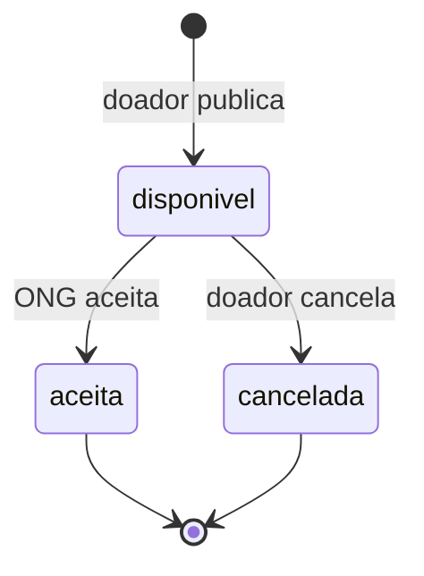
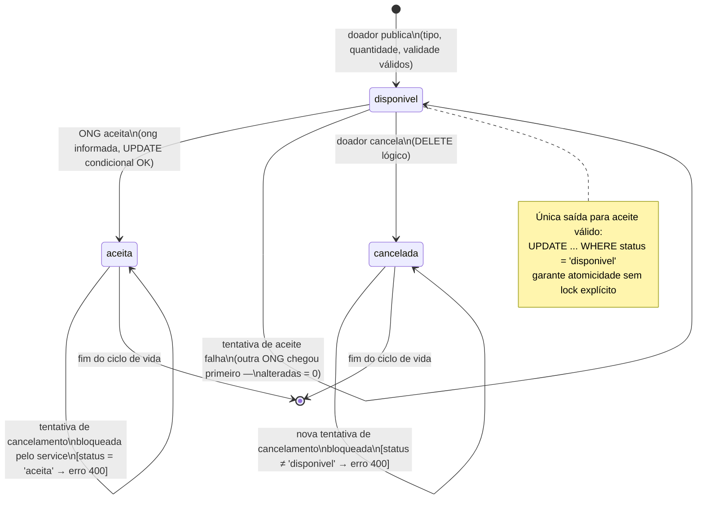
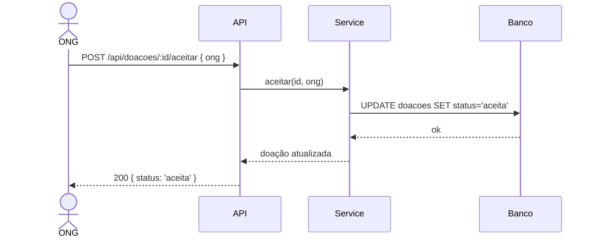
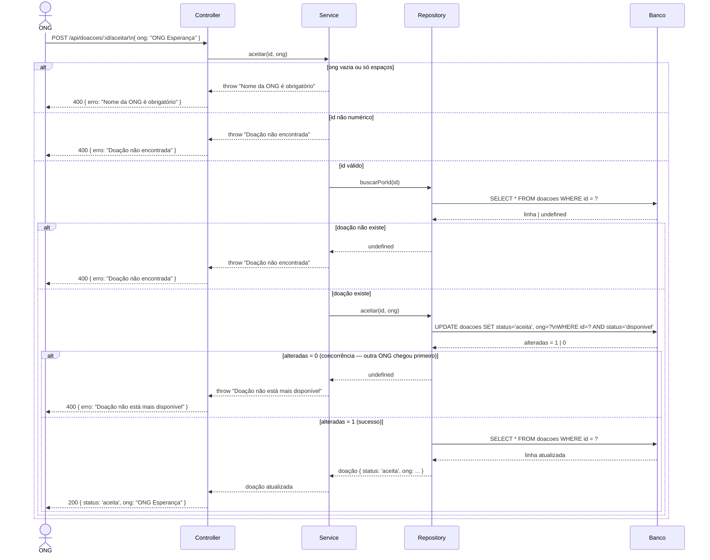

# Diagramas — Prato Cheio

*Iteração 2 · 28/10/2026 · Grupo: Bárbara, Ana, Leonardo, Marcelo, Willian*  
*Ferramenta de IA utilizada: Kiro (Claude)*

---

## Diagramas escolhidos e justificativa

| # | Tipo | Justificativa |
|---|---|---|
| 1 | **Estados (UML)** | Uma doação passa por estados bem definidos (`disponivel`, `aceita`, `cancelada`). O diagrama de estados deixa visível quais transições são permitidas e quais são bloqueadas — especialmente a regra de que uma doação aceita não pode ser cancelada. |
| 2 | **Sequência (UML)** | O fluxo de aceite de doação envolve vários componentes (Controller → Service → Repository → Banco) e tem um cenário crítico de concorrência. O diagrama de sequência mostra a ordem das mensagens e o comportamento em caso de corrida entre duas ONGs. |

---

## Diagrama 1 — Estados de uma Doação

### Versão inicial gerada pela IA

---

### Análise crítica — problemas identificados

**Problema 1:** A IA não representou a regra de negócio que impede o cancelamento de uma doação já aceita. No diagrama acima, não há nenhuma indicação de que a transição `aceita → cancelada` é proibida — quem lê o diagrama pode entender que é possível.

> **Justificativa:** Em `doacoesService.js`, a função `cancelar()` verifica explicitamente `if (doacao.status === 'aceita') throw new Error(...)`. Omitir essa restrição torna o diagrama inconsistente com a implementação real.

> **Correção:** Adicionar uma nota explícita de transição bloqueada entre `aceita` e `cancelada`, e representar o estado final de cada caminho com clareza.

---

**Problema 2:** A IA não representou o estado de erro/rejeição — quando o id não existe ou a doação já foi aceita por outra ONG, o sistema retorna 400 sem mudar de estado. O diagrama sugere que toda tentativa de aceite sempre transiciona para `aceita`.

> **Justificativa:** O UPDATE condicional `WHERE status = 'disponivel'` pode retornar `alteradas = 0`, mantendo o estado inalterado. Isso é um caminho alternativo relevante que o diagrama original ignora.

> **Correção:** Adicionar uma transição de auto-loop em `disponivel` representando a tentativa de aceite que falha (concorrência), e em `aceita` representando a tentativa de cancelamento bloqueada.

---

### Versão corrigida pelo grupo

---

## Diagrama 2 — Sequência: ONG aceita uma doação (incluindo concorrência)

### Versão inicial gerada pela IA

---

### Análise crítica — problemas identificados

**Problema 3:** A IA ignorou a camada de Repository. O Service não fala diretamente com o Banco — ele chama `repo.buscarPorId()` e depois `repo.aceitar()`, que são funções do Repository. O diagrama colapsa duas camadas em uma, o que é inconsistente com a arquitetura real do projeto (Controller → Service → Repository → db.js → Banco).

> **Justificativa:** A separação em camadas é uma decisão arquitetural documentada no ADR-0002. Representar Service falando diretamente com o Banco contradiz essa decisão e confunde quem vai manter o código.

> **Correção:** Adicionar o participante Repository entre Service e Banco, com as duas chamadas reais: `buscarPorId` e `aceitar`.

---

**Problema 4:** A IA não representou os fluxos alternativos — validação do nome da ONG, doação não encontrada e concorrência (duas ONGs tentando aceitar ao mesmo tempo). O diagrama mostra apenas o caminho feliz.

> **Justificativa:** O cenário de concorrência é o mais crítico do sistema e motivou o UPDATE condicional. Omiti-lo no diagrama de sequência perde justamente o aspecto que torna essa operação não trivial.

> **Correção:** Adicionar blocos `alt` para os três casos: ONG sem nome, doação não encontrada e concorrência (alteradas = 0).

---

### Versão corrigida pelo grupo

---

## Reflexão final

**Qual dos dois diagramas foi mais útil para compreender ou questionar uma decisão do projeto?**

O diagrama de **sequência** foi o mais útil. Ao tentar representar o fluxo de aceite, ficou evidente que a IA havia colapsado as camadas Controller/Service/Repository em uma única "API", escondendo justamente a decisão arquitetural mais importante da iteração (ADR-0002). Além disso, a versão corrigida deixou explícito o UPDATE condicional como mecanismo de controle de concorrência — algo que no código está em uma única linha, mas que o diagrama torna visível como decisão de projeto deliberada.

O diagrama de **estados** também foi valioso para expor a regra de negócio de que doações aceitas não podem ser canceladas, que a IA havia simplesmente omitido.
