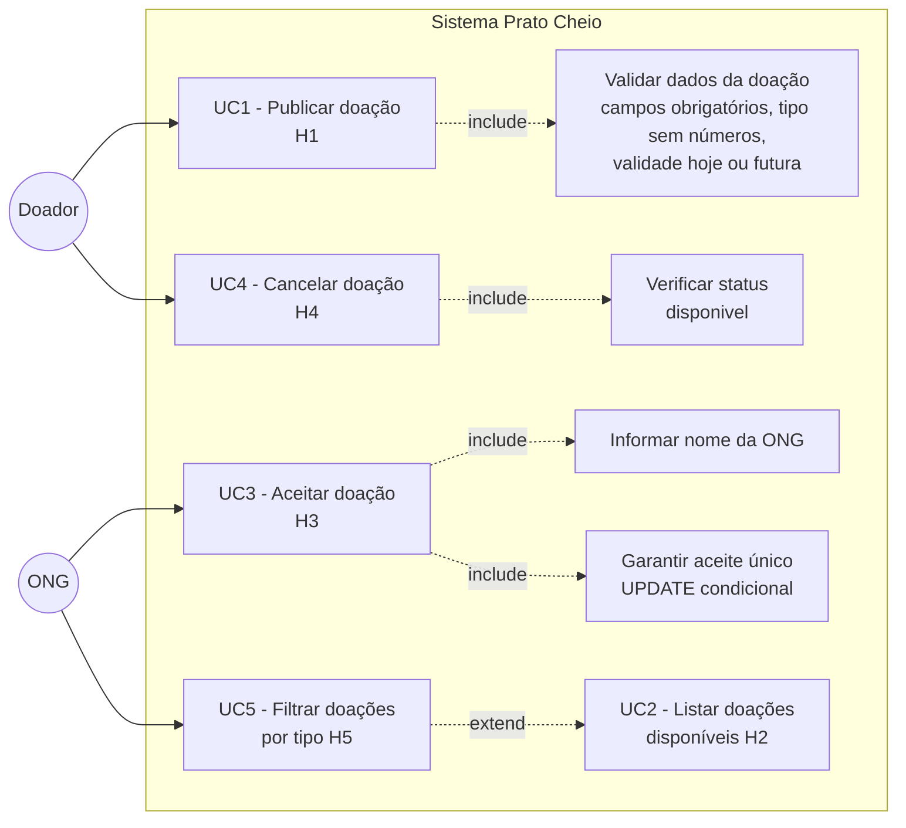
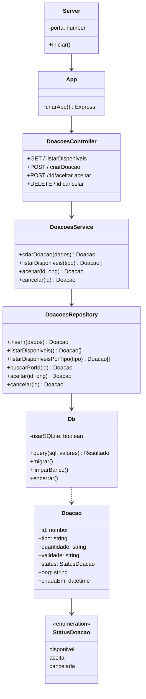

# Diagramas — Prato Cheio

*Atividade Avaliativa — Trabalho em Equipe — N2*

---

## Parte 1 — Diagramas escolhidos e justificativa

### Diagrama 1: Casos de Uso (UML)
**Justificativa:** O diagrama de casos de uso permite identificar quem interage com o sistema (Doador e ONG) e quais funcionalidades cada ator utiliza. Como o Prato Cheio tem duas personas distintas com responsabilidades diferentes (publicar vs. aceitar/filtrar), esse diagrama esclarece os limites do sistema e as dependências entre os casos de uso — especialmente as relações `«include»` e `«extend»` que refletem regras de negócio como a validação obrigatória antes de publicar.

### Diagrama 2: Classes (UML)
**Justificativa:** O diagrama de classes representa a arquitetura em camadas do sistema (Controller → Service → Repository → Db) e a entidade central `Doacao` com seus atributos e estados. Esse diagrama é útil para comunicar as decisões de projeto — especialmente a separação de responsabilidades e a abstração do banco de dados — e para verificar se a implementação é coerente com o modelo.

---

## Parte 2 — Versões iniciais geradas pela IA

### Versão inicial — Diagrama de Casos de Uso (gerado por IA)

```
Atores: Doador, ONG
Casos de uso iniciais gerados:
- UC1: Publicar doação
- UC2: Listar doações
- UC3: Aceitar doação
- UC5: Filtrar doações

Problemas na versão inicial:
- UC4 (Cancelar doação) estava ausente
- Não havia relações «include» entre publicar e validar dados
- A regra de "aceite único" (primeira ONG vence) não estava representada
- As restrições (doação aceita não pode ser cancelada) não apareciam
```

### Versão inicial — Diagrama de Classes (gerado por IA)

```
Versão inicial gerada pela IA:
- Classe única "Doacao" com atributos básicos
- Sem separação em camadas (Controller, Service, Repository, Db)
- Sem distinção entre SQLite e PostgreSQL
- Sem o enum StatusDoacao (disponivel, aceita, cancelada)
- Métodos misturados sem responsabilidade clara
```

---

## Parte 3 — Análise crítica: problemas identificados

### Problema 1 — Casos de Uso: H4 (cancelar doação) ausente e restrições não representadas

**Problema:** A versão inicial gerada pela IA não incluía UC4 (Cancelar doação — H4) e não representava as restrições das regras de negócio: doações já aceitas não podem ser canceladas, e o aceite é exclusivo para a primeira ONG.

**Justificativa:** H4 é uma história implementada no sistema (`DELETE /api/doacoes/:id`) e sua ausência tornava o diagrama inconsistente com a implementação real. As restrições são regras de negócio críticas — a condição de corrida no aceite é inclusive o risco de maior impacto registrado na análise.

**Correção:** Adicionamos UC4 com o ator Doador, incluímos a relação `«include»` com "Verificar status 'disponivel'" (compartilhada com UC3) e adicionamos notas explicando as restrições de negócio.

---

### Problema 2 — Diagrama de Classes: ausência da abstração dual SQLite/PostgreSQL e do enum de status

**Problema:** A IA gerou um diagrama com uma única classe de banco de dados sem representar que o sistema suporta dois SGBDs (SQLite para testes, PostgreSQL para produção), nem o enum `StatusDoacao` com os três estados possíveis (`disponivel`, `aceita`, `cancelada`).

**Justificativa:** A dualidade SQLite/PostgreSQL é uma das principais decisões arquiteturais da iteração (ADR-0001) e está implementada no `src/database/db.js`. Omitir isso tornava o diagrama incapaz de comunicar a decisão mais importante do projeto. O enum de status é fundamental para entender as regras de negócio — os estados determinam o que pode ou não ser feito com cada doação.

**Correção:** Adicionamos `SQLiteDatabase` e `PostgresPool` como classes separadas dentro do módulo `Db`, com a lógica de seleção via `usarSQLite: boolean`. Adicionamos o enum `StatusDoacao` com os três valores e uma nota explicando o UPDATE condicional.

---

## Parte 4 — Versões finais

Os diagramas finais estão disponíveis como imagens em `docs/`:
- Versão final do Diagrama de Casos de Uso (ver PDF anexo)
- Versão final do Diagrama de Classes (ver PDF anexo)

### Diagrama de Casos de Uso — versão final (Mermaid)



### Diagrama de Classes — versão final (Mermaid)



---

## Ferramenta de IA utilizada

- **Gemini (Google)** — geração das versões iniciais dos diagramas
- **Kiro / Claude** — apoio na identificação dos problemas e na escrita da análise crítica

---

## Reflexão final

**Qual dos dois diagramas foi mais útil para compreender ou questionar uma decisão do projeto?**

O **Diagrama de Classes** foi mais útil. Ao tentar representar a arquitetura em camadas, o grupo percebeu que a versão inicial da IA não refletia a decisão mais importante da iteração: a abstração dual SQLite/PostgreSQL no `db.js`. Esse diagrama forçou uma discussão sobre por que essa separação existe e quais são as consequências dela — o que acabou sendo documentado no ADR-0001. O diagrama de casos de uso foi valioso para validar que todas as histórias estavam representadas, mas não gerou questionamentos tão profundos sobre as decisões arquiteturais.

---

## Localização no repositório

| Artefato | Caminho |
|---|---|
| Este documento | `docs/diagramas.md` |
| ADR migração SQLite → PostgreSQL | `docs/adr/0001-sqlite-ou-postgresql.md` |
| ADR SQL puro vs ORM | `docs/adr/0002-sql-puro-ou-orm.md` |
| Histórias e RNFs | `docs/projeto.md` |
| Testes | `tests/doacoes.test.js` |
| Implementação das histórias | `src/services/doacoesService.js` |
